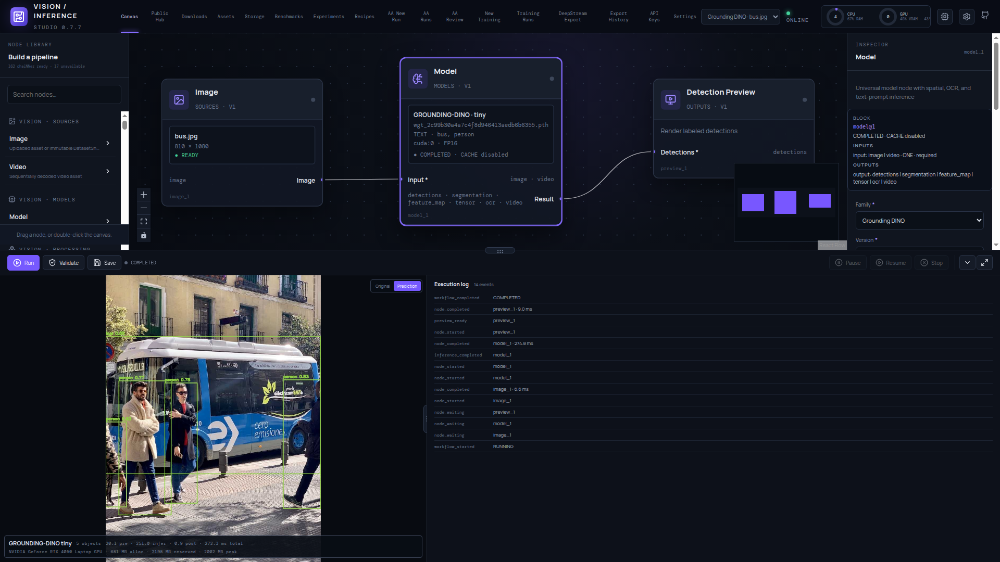

# Vision Inference Studio — Downloads

Vision Inference Studio is a desktop app for building and running image and video inference workflows locally, on an NVIDIA GPU or on the CPU. You connect inputs, models and previews on a visual Canvas, then turn a tested workflow into an auto-annotation run, a training run, or a DeepStream deployment bundle.

This repository contains **installable packages, the user manual and release notes only**. It holds no source code.



*Version 0.7.7: an Image → Grounding DINO → Detection Preview workflow on the Canvas. The prompt `bus, person` finds 5 objects in 272 ms on an RTX 4050; Live Output shows the labelled result with timings, GPU memory and the execution log.*

## Download

**Latest Linux/Windows version: 0.7.9** — [Release page](https://github.com/avinash064/vision-inference-studio-releases/releases/tag/v0.7.9) · [What's new](versions/0.7.9/README.md)

**Latest macOS version: 0.7.10** (first macOS build) — [Release page](https://github.com/avinash064/vision-inference-studio-releases/releases/tag/v0.7.10) · [What's new](versions/0.7.10/README.md)

The installer picks the PyTorch build for your computer's GPU and driver: CPU-only, CUDA 11.8, CUDA 12.1, or CUDA 12.8 for RTX 50-series GPUs. Workflows don't run on RTX 50-series GPUs in 0.7.7 and earlier. macOS has no CUDA, so it always installs the CPU/Apple MPS build.

| Version | Package | Notes |
|---|---|---|
| **0.7.10** (macOS, latest) | [Vision-Inference-Studio-darwin-arm64-0.7.10.zip](https://github.com/avinash064/vision-inference-studio-releases/releases/download/v0.7.10/Vision-Inference-Studio-darwin-arm64-0.7.10.zip) | [Release notes](versions/0.7.10/README.md) — Apple Silicon only, unsigned (see Quick start below) |
| **0.7.9** (Linux/Windows, latest) | [vision-inference-studio_0.7.9_amd64.deb](https://github.com/avinash064/vision-inference-studio-releases/releases/download/v0.7.9/vision-inference-studio_0.7.9_amd64.deb) | [Release notes](versions/0.7.9/README.md) |
| 0.7.8 | [vision-inference-studio_0.7.8_amd64.deb](https://github.com/avinash064/vision-inference-studio-releases/releases/download/v0.7.8/vision-inference-studio_0.7.8_amd64.deb) | [Release notes](versions/0.7.8/README.md) |
| 0.7.7 | [vision-inference-studio_0.7.7_amd64.deb](https://github.com/avinash064/vision-inference-studio-releases/releases/download/v0.7.7/vision-inference-studio_0.7.7_amd64.deb) | [Release notes](versions/0.7.7/README.md) — models don't run on RTX 50-series GPUs; use 0.7.8 |
| 0.7.6 | [vision-inference-studio_0.7.6_amd64.deb](https://github.com/avinash064/vision-inference-studio-releases/releases/download/v0.7.6/vision-inference-studio_0.7.6_amd64.deb) | [Release notes](versions/0.7.6/README.md) — **private runtime install fails; use 0.7.7** |
| 0.7.4 | [vision-inference-studio_0.7.4_amd64.deb](https://github.com/avinash064/vision-inference-studio-releases/releases/download/v0.7.4/vision-inference-studio_0.7.4_amd64.deb) | [Release notes](versions/0.7.4/README.md) |
| 0.5.0 | [vision-inference-studio_0.5.0_amd64.deb](https://github.com/avinash064/vision-inference-studio-releases/releases/download/v0.5.0/vision-inference-studio_0.5.0_amd64.deb) | [Release notes](versions/0.5.0/README.md) |
| 0.4.0 | [vision-inference-studio_0.4.0_amd64.deb](https://github.com/avinash064/vision-inference-studio-releases/releases/download/v0.4.0/vision-inference-studio_0.4.0_amd64.deb) | [Release notes](versions/0.4.0/README.md) |
| 0.3.0 | [vision-inference-studio_0.3.0_amd64.deb](https://github.com/avinash064/vision-inference-studio-releases/releases/download/v0.3.0/vision-inference-studio_0.3.0_amd64.deb) | [Release notes](versions/0.3.0/README.md) |
| 0.2.0 | [vision-inference-studio_0.2.0_amd64.deb](https://github.com/avinash064/vision-inference-studio-releases/releases/download/v0.2.0/vision-inference-studio_0.2.0_amd64.deb) | [Release notes](versions/0.2.0/README.md) |

Use the latest version unless you need an older one for a specific reason. Older versions are kept for reference and are not updated.

The packages are attached to each version's [GitHub Release](https://github.com/avinash064/vision-inference-studio-releases/releases) because they are larger than GitHub allows for files inside a repository. Checksums for all of them are in [SHA256SUMS](SHA256SUMS).

## Quick start (0.7.9)

**Requirements:** 64-bit Ubuntu or Debian (x86_64) with a desktop session. An NVIDIA GPU is optional (driver 525 or newer; 570 or newer for RTX 50-series GPUs). Without one, the app uses the CPU.

1. Download the `.deb` and check it:
   ```bash
   sha256sum vision-inference-studio_0.7.9_amd64.deb
   # must match: 64ac38f9e87326250c071f5830d0e4531549fc22cf8dce755a7269c41698cb4b
   ```
2. Install it:
   ```bash
   sudo apt install ./vision-inference-studio_0.7.9_amd64.deb
   ```
   The installer looks for a Python environment on your computer that already has the required packages and uses it. If none is found, it installs a private runtime for you (10–30 minutes, needs internet).
3. Start **Vision Inference Studio** from the application menu.
4. Add your model weights from the **Model** node's **Upload weights** button, then build your first workflow. The [User Manual](USER_MANUAL.md#4-your-first-workflow) walks you through it.

## Quick start (0.7.10, macOS)

**Requirements:** Apple Silicon Mac (arm64). No GPU/CUDA requirement — inference runs on CPU, with PyTorch's Apple MPS backend where supported.

1. Download the `.zip` and check it:
   ```bash
   shasum -a 256 "Vision-Inference-Studio-darwin-arm64-0.7.10.zip"
   # must match: 70e44a60247bd42e3983cd03d7952f1e1a16804efcbf72ce09b4a18d4559cdf4
   ```
2. Unzip it and move `Vision Inference Studio.app` to `/Applications` (or run it in place).
3. This build is **not notarized** (no Apple Developer ID certificate yet), so a plain double-click is blocked by Gatekeeper the first time. Either right-click the app → **Open** → **Open** in the dialog, or run:
   ```bash
   xattr -dr com.apple.quarantine "/Applications/Vision Inference Studio.app"
   ```
4. On first launch, the app installs its private Python runtime (10–30 minutes, needs internet).
5. Add your model weights from the **Model** node's **Upload weights** button, then build your first workflow.

## Documentation

- **[User Manual](USER_MANUAL.md):** install, first workflow, every page of the app, settings, troubleshooting and uninstall.
- **[Release notes](versions/):** one README per version, with what changed, its requirements and how to install it.

## Verify a download

Each package's SHA-256 checksum is in [SHA256SUMS](SHA256SUMS) and on its release page. After downloading one or more packages into the same folder:

```bash
sha256sum --ignore-missing -c SHA256SUMS
```

Every downloaded file should report `OK`.

## Reporting a problem

Open an [issue](https://github.com/avinash064/vision-inference-studio-releases/issues) and attach the three log files from **Help → Open Logs Folder** (`electron.log`, `backend.log`, `runtime-setup.log`), plus the output of `nvidia-smi` if you have an NVIDIA GPU. Remove any private paths or names from the logs before posting.
