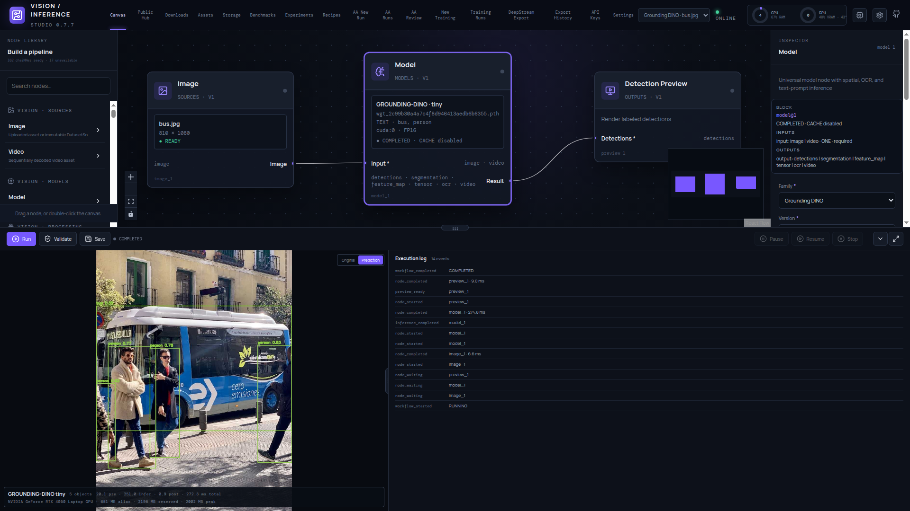
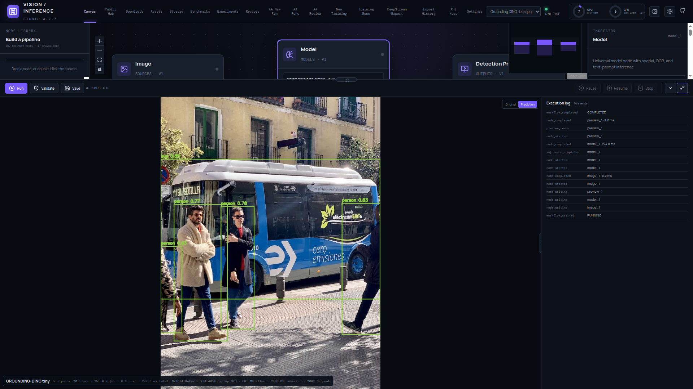

# Vision Inference Studio — User Manual

This manual covers **version 0.7.11** on Linux (the features of 0.7.6, the runtime install fix of 0.7.7, RTX 50-series GPU support from 0.7.8, the PyTorch build matched to your GPU from 0.7.9, and the chaiNNer and GPU-default fixes of 0.7.11). For the macOS build, see [0.7.10](versions/0.7.10/README.md). For earlier versions, see the README in [versions/](versions/); features that arrived later are marked with the version that added them.

## Contents

1. [What the app does](#1-what-the-app-does)
2. [Requirements](#2-requirements)
3. [Install, upgrade and the Python runtime](#3-install-upgrade-and-the-python-runtime)
4. [Your first workflow](#4-your-first-workflow)
5. [Canvas in detail](#5-canvas-in-detail)
6. [Models and weights](#6-models-and-weights)
7. [Public Hub, benchmarks, experiments and recipes](#7-public-hub-benchmarks-experiments-and-recipes)
8. [Auto Annotation](#8-auto-annotation)
9. [Storage and datasets](#9-storage-and-datasets)
10. [Training](#10-training)
11. [DeepStream export](#11-deepstream-export)
12. [NVIDIA TAO (optional)](#12-nvidia-tao-optional)
13. [API keys and credentials](#13-api-keys-and-credentials)
14. [Where your data is stored](#14-where-your-data-is-stored)
15. [Troubleshooting](#15-troubleshooting)
16. [Uninstall](#16-uninstall)

---

## 1. What the app does

Vision Inference Studio runs computer-vision models on your own machine. You build a **workflow** on the Canvas by connecting nodes: an input (image, video or dataset item), optional preprocessing, one or more models, and a preview. The app shows the result with timing and GPU memory figures.

A workflow you are happy with can then be:

- **compared** with others on a fixed benchmark (Experiments),
- **frozen** as a recipe and run over a whole folder, video or dataset (Auto Annotation),
- used to **train or fine-tune** a model on your own labelled data (Training),
- **exported** as a validated NVIDIA DeepStream bundle (DeepStream Export).

Everything runs locally. Cloud storage and model hubs are used only when you connect them.

## 2. Requirements

| Item | Requirement |
|---|---|
| Operating system | 64-bit Ubuntu or Debian (x86_64) with a desktop session (GNOME, KDE, …) |
| Disk | About 15 GB free if the private runtime is installed (mostly PyTorch and CUDA libraries), plus space for your weights and datasets |
| RAM | 16 GB recommended; loading SAM 3 briefly needs 6–7 GB |
| GPU (optional) | NVIDIA GPU with driver 525 or newer (`nvidia-smi` should work). RTX 50-series and other Blackwell GPUs need version 0.7.8 or newer and driver 570 or newer; see [Which PyTorch is installed](#which-pytorch-is-installed-079-and-later). Without a GPU, the app uses the CPU (the installer then installs the smaller CPU-only PyTorch), which is much slower. |
| Internet | Needed only if the installer has to download the private runtime, and for cloud storage or model hubs |
| Python | Not required. The package includes its own Python 3.12. |

Optional extras:

- **Tesseract OCR** is installed automatically as a package dependency.
- **DeepStream runtime testing** and **NVIDIA TAO** need Docker with the NVIDIA Container Toolkit. See [section 12](#12-nvidia-tao-optional).

## 3. Install, upgrade and the Python runtime

### Install

```bash
sudo apt install ./vision-inference-studio_0.7.11_amd64.deb
```

Then start **Vision Inference Studio** from the application menu, or run `vision-inference-studio` in a terminal.

### How the installer prepares Python (0.7.6 and later)

The app's models run in a Python environment. While the package installs, it prepares that environment for the user who ran `sudo`, in this order:

1. **Keep what works.** If you already set up a runtime for an earlier version and it is still compatible, it is kept and nothing is installed.
2. **Reuse an existing environment.** Otherwise the installer searches your computer for a Python environment that already has the required packages. It looks in `~/venv`, `~/.venv`, `~/<project>/venv`, conda / miniforge / mamba environments, pyenv, pipenv, `/opt/*/venv`, other virtualenvs up to four folders deep in your home folder, and the system Python. If it finds one, it uses it as-is: **no new environment is created and nothing is installed.** The check only reads which packages are installed and tries importing them; it never changes the environment.
3. **Install only if nothing fits.** It creates a private runtime in `~/.local/share/vision-inference-studio/runtime`. This downloads about 4 GB and takes 10–30 minutes.

An environment counts as compatible when it has Python 3.10 or newer and the required packages: PyTorch, torchvision, Ultralytics, RF-DETR, ONNX Runtime, Transformers, the web server and the cloud SDKs, all within the supported versions. Missing optional packages (PaddleOCR, chaiNNer, Grounding DINO) do not block reuse; those features show as unavailable. If several environments qualify, it prefers the one with the most features and, on a machine with an NVIDIA GPU, one whose PyTorch can use CUDA.

If the runtime can't be prepared during installation, for example because there is no internet or you installed with a graphical software centre, installation still succeeds. The app then shows **Inference Runtime Setup** on first launch. Click **Install Runtime**: it runs the same search first and installs only if needed.

### Choose or check the environment yourself

```bash
vision-inference-studio-setup --discover                   # list compatible environments; changes nothing
vision-inference-studio-setup --use-python ~/myenv/bin/python   # check one interpreter and use it
vision-inference-studio-setup --mode auto                  # rerun the installer's choice
```

Installer options, passed through `sudo`:

| Option | Effect |
|---|---|
| `sudo VIS_SKIP_RUNTIME_SETUP=1 apt install ./…deb` | Don't prepare the runtime during installation; do it on first launch |
| `sudo VIS_RUNTIME_DISCOVERY=0 apt install ./…deb` | Always use the private runtime, never an existing environment |
| `sudo VIS_INSTALL_USER=<name> apt install ./…deb` | Prepare the runtime for that user |

Your choice is saved in `~/.config/vision-inference-studio/python-runtime`. A path you set yourself is never replaced. If an environment the installer found is later deleted, the next setup run chooses again.

**Runtime → Status** in the menu bar shows which environment is in use and whether CUDA is available. **Runtime → Repair Runtime** and **Reinstall Runtime** fix a damaged private runtime.

### Which PyTorch is installed (0.7.9 and later)

The app's models run on PyTorch. The installer picks the PyTorch build that suits **the GPU and NVIDIA driver of the computer it is installed on**, using what `nvidia-smi` reports:

| Your computer | PyTorch installed |
|---|---|
| No NVIDIA GPU, or the NVIDIA driver isn't installed | 2.5.1, CPU-only. No CUDA libraries, so about 3 GB less to download. |
| NVIDIA GPU older than compute capability 5.0 (for example Tesla K80), or a driver older than 450 | 2.5.1, CPU-only. PyTorch can't use these GPUs. |
| NVIDIA driver 450–524 | 2.5.1 for CUDA 11.8 |
| NVIDIA driver 525 or newer, GPUs up to the RTX 40-series, L4 and H100 | 2.5.1 for CUDA 12.1 (the tested build) |
| RTX 50-series (5050, 5060, 5070, 5080, 5090; desktop and laptop), RTX PRO Blackwell and other GPUs of compute capability 10.0 or newer | 2.7.1 for CUDA 12.8 (needs driver 570 or newer; since 0.7.8) |

If your computer has several GPUs, the newest one decides. Every other package stays at the same tested version.

**Check the choice:** run `vision-inference-studio-setup --print-torch-build`. It prints the build, the reason and your GPU, and installs nothing. `runtime-setup.log` records the same.

**After a driver update or a new GPU,** click **Runtime → Repair Runtime**. Setup rebuilds the private runtime with the matching build and removes the old CUDA libraries. On a computer that got the CPU build because no driver was installed, **Runtime → Status** reminds you to do this.

**To force a build,** set `VIS_TORCH_BUILD` to `cpu`, `cu118`, `cu121` or `cu128` when running `vision-inference-studio-setup`.

More checks for GPUs PyTorch can't use:

- An environment whose PyTorch has no code for your GPU is not picked by the environment search.
- **Runtime → Status** shows `GPU NOT SUPPORTED BY PYTORCH` when the PyTorch in use can't run on your GPU.

A Python environment you chose yourself is never changed. To make it work on an RTX 50-series GPU, upgrade its PyTorch:

```bash
/path/to/your/python -m pip install --upgrade torch==2.7.1 torchvision==0.22.1 --index-url https://download.pytorch.org/whl/cu128
```

### Upgrade

Install the newer `.deb` the same way. Your weights, workflows, recipes, benchmarks, datasets, training runs, exports and settings are kept. If the private runtime needs new packages, the installer updates it, or the app shows **Runtime update required**; click **Update Runtime**.

To reinstall the same version, use `sudo dpkg -i ./vision-inference-studio_0.7.11_amd64.deb`, because `apt` skips a version that is already installed.

## 4. Your first workflow



1. Open **Canvas**.
2. On the empty Canvas, choose a starter: **YOLO**, **RF-DETR**, **RT-DETR** or **Segmentation**. This adds an Image input, a Model node and a matching preview, already connected.
3. Select the **Image** node and upload a test image, or choose one you added before.
4. Select the **Model** node:
   - choose the **family**, **version** and **size** that match your checkpoint;
   - click **Upload weights** and pick your checkpoint file (see [section 6](#6-models-and-weights) for accepted formats);
   - choose **device** (CUDA or CPU) and **precision** (`fp16` on a GPU, `fp32` on the CPU). From 0.7.11, a new model node starts on your NVIDIA GPU with `fp16` when you have one;
   - set the **confidence** threshold.
5. Click **Validate**. Fix any issue it lists; each one names the node and the problem.
6. Click **Run**.

The result appears in the **Live Output** panel at the bottom: boxes or masks drawn on the image, the detection count, and pre-processing, inference and post-processing times with GPU memory.

### The Live Output panel



- **Original / Prediction** switches between the input and the drawn result without re-running.
- **Enlarge** (the maximise icon at the right of the toolbar) grows the panel to nearly full height; click it again to restore.
- **Minimize** (the chevron) collapses the panel to its toolbar.
- **Drag** the top edge to change its height and the divider to change the preview width. Double-click the top edge to enlarge or restore. Your size is remembered.
- The tabs below show the execution log, validation issues, recent events and the performance table.

## 5. Canvas in detail

### Building a graph

- Add nodes from the **node library**: inputs, preprocessing, models, post-processing, previews and the chaiNNer image-processing nodes.
- Connect an output port to an input port. Ports are typed (image, detections, masks, features, text and so on); the Canvas only allows compatible connections and the inspector shows what each port carries.
- A model's output can feed another model: for example detector → crop → classifier, or detector → SAM to turn boxes into masks. One node's output can fan out to several nodes.

### Running part of a graph

Right-click a node, or use the inspector, to:

- **Run Node:** run only that node, using upstream results that are still valid;
- **Run Until:** run everything up to that node;
- **Run From:** rerun from that node onward.

Each node shows its state: `NOT_RUN`, `RUNNING`, `COMPLETED`, `FAILED` or `CACHED`. Click a node to inspect its inputs, outputs, timing and errors.

### Caching

Results are cached by each node's settings and inputs. If you change only a downstream node, for example the classifier's threshold, the upstream detector result is reused (`CACHED`) and only the changed part runs again. Moving or zooming the Canvas never invalidates the cache.

### Prompt models

| Model | What to enter |
|---|---|
| Grounding DINO | Comma-separated object names, such as `person, car` |
| SAM, SAM 2.1 | A point `x,y` or a box `x1,y1,x2,y2` in image pixels |
| SAM 3 | Text such as `person` to find every instance, or a point or box for one object |
| PaddleOCR / Tesseract | The OCR language |
| vLLM | The endpoint and model name, then an instruction such as `Read all visible text` |

### Saving

Use **Save** (Ctrl+S) to store the workflow and **File → Open Workflow** (Ctrl+O) to reopen one.

## 6. Models and weights

| Family | What it does | Weight files |
|---|---|---|
| YOLO (v3–v12, v26) | Object detection | `.pt`, `.onnx`, `.engine` |
| YOLO Segmentation | Masks and polygons | `.pt`, `.onnx`, `.engine` |
| RT-DETR (Ultralytics) | Object detection | `.pt` |
| RT-DETRv2 (official) | Object detection | `.pth` |
| RF-DETR (nano to large) | Object detection | `.pth`, `.pt` |
| DINOv3 | Feature maps | `.pth`, `.pt` |
| Grounding DINO | Finds objects you name in text | `.pth` |
| SAM | Segments what you point at | `.safetensors`, `.bin`, `.pth`, `.pt` |
| SAM 2 / 2.1 / 3 | Segmentation by point, box or text (SAM 3) | `.pt` |
| PaddleOCR, Tesseract | Text reading | no weights needed |
| vLLM | Remote vision-language model | uses your server |
| Generic ONNX | Any single-input image model | `.onnx` |

**No weights are included in the packages.** Add your own with **Upload weights** on the Model node, or download models from the **Public Hub**. Imported models appear under **Assets**, where **Open in Canvas** creates a ready-to-run graph.

**RF-DETR patch size:** choose the size and patch size the checkpoint was trained with. Base uses 14; Nano, Small and Medium use 16; Large can be 14 (legacy) or 16 (current). A wrong choice shows tensor-shape or positional-encoding errors when loading.

Only load checkpoints from sources you trust: PyTorch checkpoint files can contain code.

## 7. Public Hub, benchmarks, experiments and recipes

1. **Public Hub:** search Hugging Face, Roboflow or Kaggle. Select **Download & register**, then follow progress on **Downloads**. Downloads are checked before registration and never run any code.
2. **Assets:** lists imported datasets and models with their checksums and where they came from.
3. **Benchmarks:** create a fixed random, stratified or manual sample of a dataset.
4. **Experiments:** run two or more saved workflows on the same benchmark and compare latency, memory, accuracy (when ground truth exists) and the rendered outputs.
5. **Recipes:** promote the best workflow. A recipe pins the exact workflow, models, checkpoints and their checksums, so it always runs the same way.

## 8. Auto Annotation

Auto Annotation runs a recipe over many images and saves the kept predictions as a dataset package.

1. Open **AA New Run** and choose a source: an approved local image folder, a video, or a dataset snapshot (see [section 9](#9-storage-and-datasets)).
2. Check the source details. For video, choose the sampling: a target FPS, a time interval, or every N-th frame, and look at the sample frames.
3. Choose a promoted recipe version, or **Pull current Canvas into AA** to freeze your current Canvas as a new recipe. Preflight checks the models, checkpoints, device and prompts before anything runs.
4. Preview inference on a few items.
5. Set what to keep: by confidence, box area, count, classes, and optional minimum spacing between video frames.
6. Start the run. **AA Runs** shows sampled, inferred, kept, exported and failed counts. Runs survive an app restart and can be resumed after a cancel or failure without repeating finished items.
7. When it finishes, open the package folder, or copy a ready-made `gcloud storage rsync` or `aws s3 sync` command to upload it.
8. Open **AA Review** to look through the boxes, masks, OCR text and confidences.

Each package contains the kept images, annotations in canonical JSONL, COCO and YOLO formats, a manifest, the exact recipe, the run settings, a failure list and checksums for every file. It is validated before being marked ready.

## 9. Storage and datasets

### Connections

The **Storage** page connects Local folders, Google Cloud Storage and AWS S3. For each connection you can test access, browse folders, preview images, download, and upload single files. Uploads never overwrite existing files unless you allow it.

Cloud credentials are **not** typed into the app. A connection stores only the *name* of an environment variable, written as `env:VARIABLE_NAME`. Put the actual value in `~/.config/vision-inference-studio/.env`:

```bash
# Example for Google Cloud: point to a service-account key file
echo 'MY_GCS_KEY=/home/you/keys/gcs-service-account.json' >> ~/.config/vision-inference-studio/.env
chmod 600 ~/.config/vision-inference-studio/.env
```

Restart the app after editing `.env`.

### Datasets and snapshots

In **Storage → Datasets** you register a dataset from a `manifest.jsonl` file in any connection:

- **FAST** validation checks the manifest's structure; **DEEP** validation also opens the images, either all of them or a sample.
- A **Dataset** follows the current manifest. A **Snapshot** pins one exact version, so a run or training job can always be repeated on the same data.
- Search, filter by prefix and page through items, with image previews.

Snapshots can be used as the Canvas Image input, as an Auto Annotation source and as training data.

## 10. Training

Added in 0.7.6.

1. Open **New Training**.
2. Choose a **dataset snapshot** and its **COCO labels**.
3. Choose the **model**: Ultralytics YOLO (detection or segmentation), RF-DETR or RT-DETR. The form shows that model's settings: epochs, image size, batch, learning rate and so on. To fine-tune, start from a registered model.
4. Choose the train/validation split. The split is saved, so the same settings always give the same split.
5. Start. **Training Runs** shows each epoch's loss, mAP and learning rate on charts, plus the raw logs.
6. When it finishes, the best and last checkpoints are kept with checksums. Click **Register Best Model** to add it to your models. From there you can **Test in Canvas**, **Fine-tune** again, or start a **DeepStream Export**.

The registered model records where it came from: dataset snapshot, labels, split, settings and metrics.

## 11. DeepStream export

Added in 0.7.6.

**DeepStream Export** turns a registered YOLO, RT-DETR or RF-DETR checkpoint into a bundle that NVIDIA DeepStream's `nvinfer` can load.

1. Choose the model and the input size (a multiple of 8; YOLO also needs a multiple of 32, and RF-DETR a square size divisible by its patch block).
2. Choose where to save: a local folder, or a storage connection to upload to.
3. Start. The app exports ONNX and validates it three ways: the ONNX checker, ONNX Runtime, and a comparison of ONNX results against the original model on a sample image.

The bundle contains the ONNX model, labels, `config_infer_primary.txt`, a `deepstream-app` config fragment, metadata, checksums and a README. **Export History** lists past exports with their validation level. DeepStream builds its TensorRT engine the first time it loads the bundle and then reuses it.

## 12. NVIDIA TAO (optional)

Added in 0.7.6, and optional: the rest of the app works without it.

TAO 7.3 DINO and RT-DETR models can be trained from the same **New Training** page. They need:

- Docker with the NVIDIA Container Toolkit;
- an NVIDIA GPU (DINO needs about 16 GB of GPU memory, RT-DETR about 8 GB);
- an NGC API key, placed in `~/.config/vision-inference-studio/.env` as `NGC_KEY=…`;
- about 45 GB of free disk for the TAO container images.

Open **Settings → NVIDIA TAO** and run the **preflight**. It checks Docker, the NVIDIA runtime, the GPU, the driver against the container's CUDA version, disk space and GPU memory for each model, and says exactly what is missing. TAO checkpoints are validated, registered and can be exported to ONNX like other models.

## 13. API keys and credentials

Open **API Keys** to add Hugging Face, Roboflow, Kaggle or vLLM tokens. They are checked by the app and stored in `~/.config/vision-inference-studio/.env`, readable only by you. Saved values are never shown again in the app, and are never written into workflows, recipes or exports.

## 14. Where your data is stored

| Location | Contents |
|---|---|
| `~/.config/vision-inference-studio/` | Settings, `.env` credentials, `python-runtime` choice, window state |
| `~/.local/share/vision-inference-studio/weights/` | Your model weights |
| `~/.local/share/vision-inference-studio/workflows/` | Saved workflows |
| `~/.local/share/vision-inference-studio/workspace/` | Uploads, previews, Auto Annotation packages, storage metadata and caches, training runs |
| `~/.local/share/vision-inference-studio/benchmarks/` | Benchmarks |
| `~/.local/share/vision-inference-studio/runtime/` | The private Python runtime, if one was installed |
| `~/.local/share/vision-inference-studio/logs/` | `electron.log`, `backend.log`, `runtime-setup.log` |

Upgrading or uninstalling never deletes these folders.

## 15. Troubleshooting

| Problem | What to do |
|---|---|
| Most chaiNNer nodes in the Node Library show as **Unavailable** (`No module named 'nodes.properties.outputs'`) | A packaging bug in 0.7.4 to 0.7.9: part of the bundled chaiNNer code was missing. Install 0.7.11 or newer. Nodes that name `spandrel`, `tensorrt`, `ncnn` or `facexlib` need an engine the app doesn't install and stay unavailable. |
| A model runs on the CPU although you have an NVIDIA GPU (Live Output shows **CPU**) | Select the model node and set **Device** to your GPU (`cuda:0`) and **Precision** to `fp16`. Before 0.7.11, new model nodes started on the CPU. |
| Workflows don't run on an RTX 50-series GPU: `CUDA error: no kernel image is available for the execution device`, or **Runtime → Status** shows `GPU NOT SUPPORTED BY PYTORCH` | Install 0.7.8 or newer, and make sure `nvidia-smi` shows driver 570 or newer. Then click **Update Runtime**. If you chose your own environment, upgrade its PyTorch as described in [GPU support](#which-pytorch-is-installed-079-and-later). Until then, select CPU / `fp32`. |
| Runtime install fails with `ResolutionImpossible` / "Cannot install boto3<2 and >=1.35" | A bug in 0.7.5 and 0.7.6. Install 0.7.7 or newer, then click **Update Runtime**. |
| **Inference Runtime Setup** appears on first launch | The runtime wasn't prepared during installation. Click **Install Runtime**. |
| Runtime setup fails while downloading | Check your internet connection or proxy, then **Runtime → Repair Runtime**. Details are in `runtime-setup.log`. |
| The installer picked an environment you don't want | Run `vision-inference-studio-setup --use-python /path/to/python`, or delete `~/.config/vision-inference-studio/python-runtime` and run `vision-inference-studio-setup --mode auto`. |
| "Your configured Python … is not compatible" | The interpreter you chose lacks required packages. The message lists them. Install them into that environment, or delete the `python-runtime` file to let setup choose. |
| **Backend could not start** | Click **Retry**. If it fails again, read `backend.log` and use **Runtime → Repair Runtime**. |
| CUDA not available in **Runtime → Status** | Check that `nvidia-smi` works and the driver is 525 or newer (570 or newer for RTX 50-series GPUs). If the NVIDIA driver was installed after the app, click **Runtime → Repair Runtime** to replace the CPU-only PyTorch with a CUDA build. If you use your own environment, check that its PyTorch is a CUDA build. Otherwise select CPU / `fp32`. |
| RF-DETR shape or positional-encoding errors | The size or patch size doesn't match the checkpoint. See [section 6](#6-models-and-weights). |
| "CUDA out of memory" | Close other GPU programs, or **Runtime → Restart Backend** to unload models, then run again. |
| App closes immediately when started from a VS Code terminal | VS Code sets `ELECTRON_RUN_AS_NODE`. Start from the application menu, or run `env -u ELECTRON_RUN_AS_NODE vision-inference-studio`. |
| A model family shows as unavailable | Its optional package isn't installed in the environment in use. Install it there and restart the backend. |
| TAO preflight fails | Follow the item it marks FAIL: Docker, the NVIDIA runtime, the NGC key, disk space or GPU memory. |

Logs: **Help → Open Logs Folder**. When asking for help, include `electron.log`, `backend.log`, `runtime-setup.log` and the output of `nvidia-smi`.

## 16. Uninstall

```bash
sudo apt remove vision-inference-studio
```

This removes the application only. To also delete your data and the private runtime:

```bash
rm -rf ~/.local/share/vision-inference-studio ~/.config/vision-inference-studio
```

If the installer reused one of your own Python environments, that environment is not touched by uninstalling.
